# Data Assets Thumbnails for Unreal Engine

Data Asset Thumbnails plugin for Unreal Engine replaces default Data Asset icons with a custom thumbnail images. It also allows for setting up custom colors and default icons for different Data Asset types. This allows for better organization and easier asset identification when working with Data Assets. 

The plugin works on Unreal Engine: 5.3-5.8.

**Check how it looks in action**  
https://www.youtube.com/watch?v=qIrqWKTJ_nE
  
**Before Data Asset Thumbnails Plugin**  
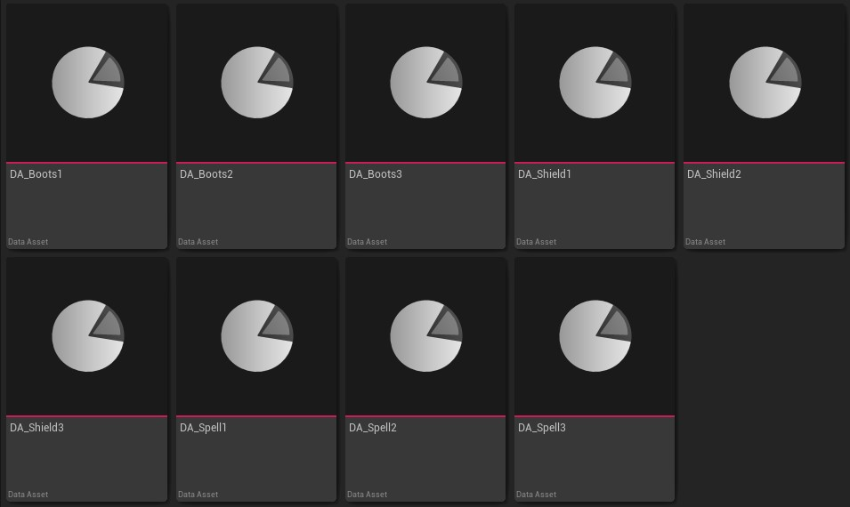

**After Data Assets Thumbnails Plugin**  
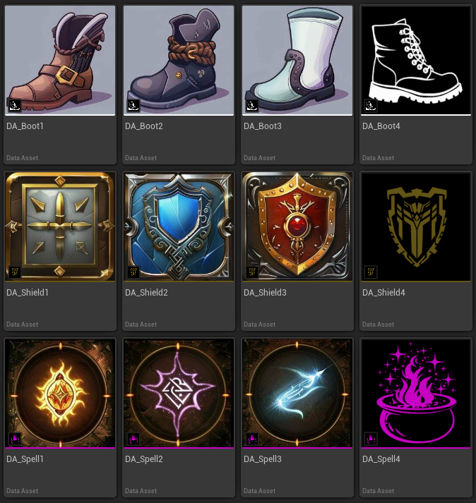

# Plugin prebuilt binaries

If you don't want to build the plugin from the source you can get the prebuilt version from Fab:  
https://www.fab.com/listings/239dd3f5-602e-4453-b161-c06191659335

# Building the Plugin

To use the Plugin in it's source form:
1. Download the repository to a new **`DataAssetsThumbnails`** directory and put that directory into your project's Plugin directory.
2. Add **`DataAssetsThumbnails`** and **`DataAssetsThumbnailsEditor`** entry to the **`PublicDependencyModuleNames`** list in your project's `Build.cs` files. (If you don't have separate `Build.cs` for the Editor build, add the **`DataAssetsThumbnailsEditor`** under the `if(Target.bBuildEditor)` condition).
3. Add ```{
			"Name": "DataAssetsThumbnails",
			"Enabled": true
		}``` entry to your project's `.uplugin` file.
4. Generate Visual Studio project file.
5. Build your game as usual :)

# Example Project  

You can checkout the example project here:  
https://github.com/zompi2/DataAssetsThumbnailsSampleProject

# Table of content

- [How to set a variable to be a Data Assets thumbnail?](#how-to-set-a-variable-to-be-a-data-assets-thumbnail)
- [How to setup default Data Assets color and icon?](#how-to-setup-default-data-assets-color-and-icon)
- [Can I have that default icon always displayed in the corner of my Data Assets?](#can-i-have-that-default-icon-always-displayed-in-the-corner-of-my-data-assets)
- [What if thumbnail don't want to change?](#what-if-thumbnail-dont-want-to-change)
- [My icons have transparency and are barely visible](#my-icons-have-transparency-and-are-barely-visible)
- [Special thanks](#special-thanks)

## How to set a variable to be a Data Assets thumbnail?  

Simply add `Thumbnail` meta tag to the property you want to use as a thumbnail.

```cpp
#pragma once

#include "CoreMinimal.h"
#include "Engine/DataAsset.h"
#include "MyDataAsset.generated.h"

UCLASS(BlueprintType, Blueprintable)
class MYPROJECT_API UMyDataAsset : public UDataAsset
{
	GENERATED_BODY()

public:

	UPROPERTY(EditAnywhere, BlueprintReadOnly, meta = (Thumbnail))
	TObjectPtr<class UTexture2D> Icon;
};
```

**How to set that variable using only BP?**  

If you define a variable inside of the `PrimaryDataAsset` and it is one of the supported type the `Is Thumbnail` checkbox can be selected to make that variable a thumbnail.  
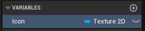  
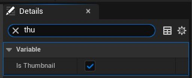  

**Which assets can be used as a thumbnail?**

* `UTexture2D` hard and soft reference
* Any `UMaterialInterface` child (`UMaterial`, `UMaterialInstance`, etc) hard and soft referece
* `FSlateBrush`
* `FColor` and `FLinearColor`

**What if I set multiple variables to be a thumbnail?**  
The first one found will be used as a thumbnail.  

**What if my thumbnail asset is inside of a struct?**  
Unfortunatelly we can't set meta tag inside of a struct, but there is a second way of defining which asset should be used as a thumbnail and this is by using `IDataAssetWithThumbnail` and by overriding `GetAssetToRender_Implementation` function.

```cpp
#pragma once

#include "Engine/DataAsset.h"
#include "IDataAssetWithThumbnail.h"
#include "DATUtils.h"
#include "MyDataAsset.generated.h"

USTRUCT(BlueprintType)
struct FIconStruct
{
	GENERATED_BODY()

	UPROPERTY(EditAnywhere, BlueprintReadWrite)
	TObjectPtr<class UTexture2D> Icon;
};

UCLASS(BlueprintType, Blueprintable)
class MYPROJECT_API UMyDataAsset : public UDataAsset, public IDataAssetWithThumbnail
{
	GENERATED_BODY()

public:

	UPROPERTY(EditAnywhere, BlueprintReadWrite)
	FIconStruct IconStruct;

	UObject* GetAssetToRender_Implementation() const override
	{
		return FDATUtils::GetRenderObjectFromObject(IconStruct.Icon);
	}
};
```

**Will it work in BP too?**

Yes it will!

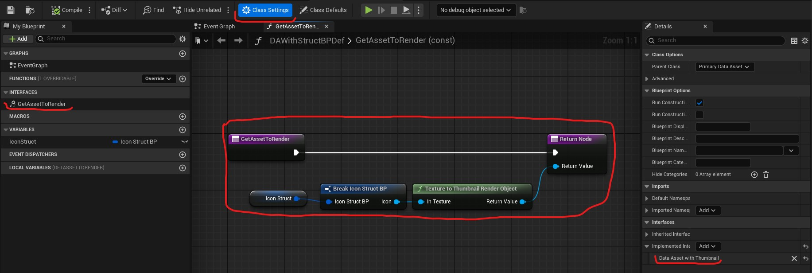

**How about FLinearColor?**

For `FColor` and `FLinearColor` another functions must be overriden: `VisualizeWithSolidColor` and `GetColorToRender`.

```cpp
#pragma once

#include "Engine/DataAsset.h"
#include "IDataAssetWithThumbnail.h"
#include "DATUtils.h"
#include "MyDataAsset.generated.h"

USTRUCT(BlueprintType)
struct FColorStruct
{
	GENERATED_BODY()

	UPROPERTY(EditAnywhere, BlueprintReadWrite)
	FLinearColor LinearColor;
};

UCLASS(BlueprintType, Blueprintable)
class MYPROJECT_API UMyDataAsset : public UDataAsset, public IDataAssetWithThumbnail
{
	GENERATED_BODY()

public:

	UPROPERTY(EditAnywhere, BlueprintReadWrite)
	FColorStruct ColorStruct;

	bool VisualizeWithSolidColor_Implementation() const override
	{
		return true;
	}

	FLinearColor GetColorToRender_Implementation() const override
	{
		return ColorStruct.LinearColor;
	}
};
```

**And in BP?**  
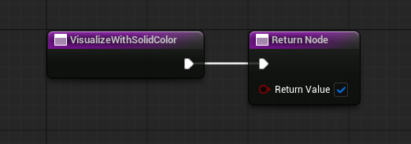  
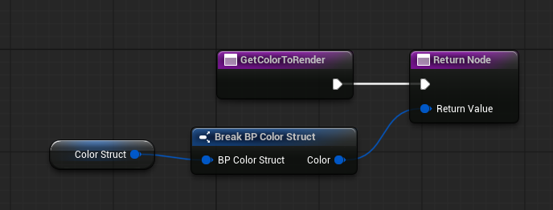  

[Back to top](#table-of-content)

## How to setup default Data Assets color and icon?  

Go to `Project Settings -> Plugins -> Data Assets Thumbnails` and fill up the `Global Overrides`

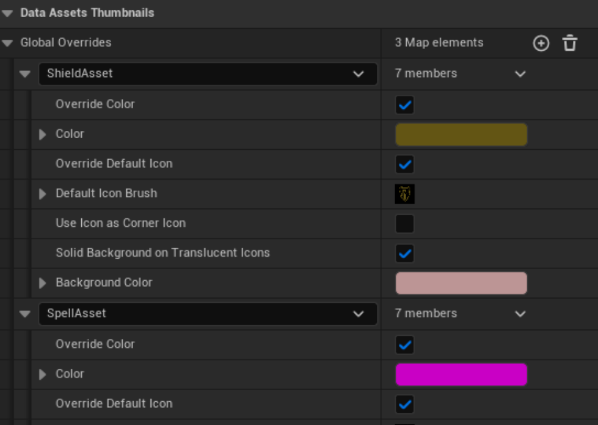  
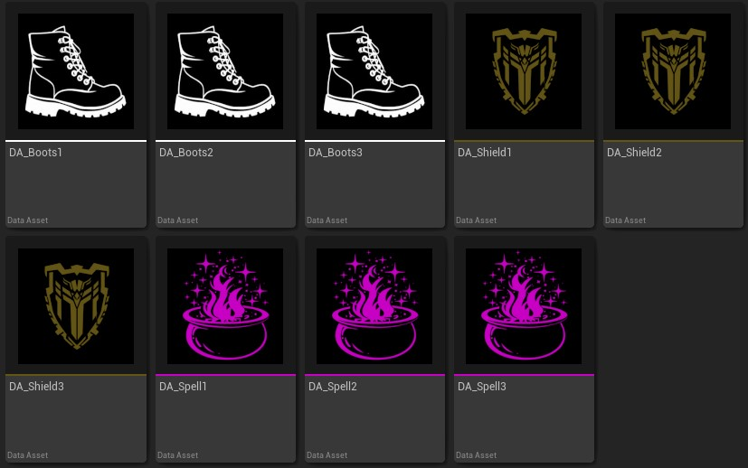  

**Can I have that default icon always displayed in the corner of my Data Assets?**  

Sure! Just enable the `Use Icon as Corner Icon` in the `Global Overrides`

   

[Back to top](#table-of-content)

## What if thumbnail don't want to change?  

Remember that in order to render a thumbnail an asset must be saved and compiled. Sometimes you need to go out from a directory and enter again.  
If everything fails, you can try to refresh a thumbnail, by right clicking the asset and selecting `Asset Actions -> Refresh Thumbnails`.  
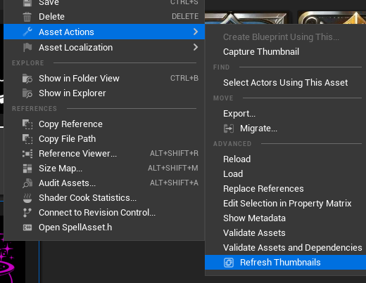  

You can also refresh multiple thumbnails by right-click on a directory and select `Refresh Thumbnails`.  
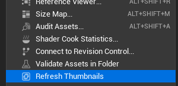  

[Back to top](#table-of-content)

## My icons have transparency and are barely visible

You can draw your icons with transparency on a solid color background, instead on the default checkerboard.  
You can enable that feature in `Project Settings -> Plugins -> Data Assets Thumbnails` with `Solid Background on Translucent Icons` option.  
You can also specify different colors for different Data Asset types in `Global Overrides` settings.  
> After changing these settings you will have to refresh your thumbnails.

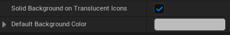  
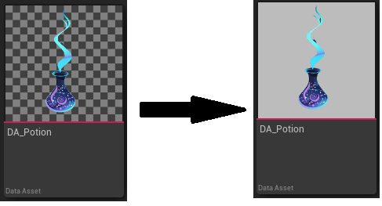  

[Back to top](#table-of-content)

## Special thanks 

I want to say thanks to Monika, for everlasting support and that she always believes in me, and to Patrick, for always encouraging me to get my shit done :)  
Also, thanks to everybody who purchased the product and who provided valuable feedback. You rock! <3

[Back to top](#table-of-content)

